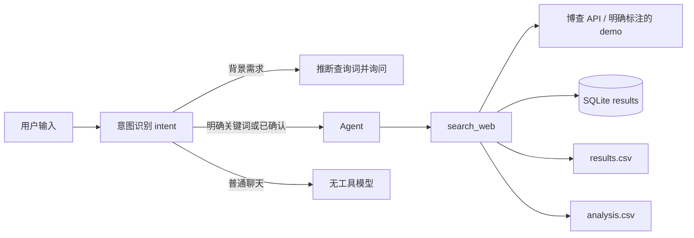

# General Search Agent

[](https://www.python.org/)
[](https://langchain-ai.github.io/langgraph/)
[](https://fastapi.tiangolo.com/)
[](https://www.sqlite.org/)
[](LICENSE)

带**意图识别与搜索确认门禁**的通用网页搜索 Agent。用户确认前不联网；支持招聘、商品及其他公开网页搜索；结果写入 SQLite 并导出 CSV。

每次确认后的搜索执行固定工具链：

```text
search_web → save_results → export_results_csv → analyze_results
```

回复展示前 5 条结果的标题、站点、摘要和完整来源 URL，固定交付 `results.csv` 和 `analysis.csv`。SQLite 仅作为内部存储，不混入导出。

> `source=demo` 是离线合成数据，只用于验证流程，不代表真实网页搜索。真实接口失败不会静默降级为 demo。

## ✨ 功能亮点

- 🔒 **确认门禁** — 背景描述先推断查询词，明确关键词才直接执行；确认前零联网。
- 🛠️ **工具链编排** — 搜索→入库→导出→分析四步固定流程，每步独立可测试。
- 🔁 **增量去重** — SQLite 按 `(source, external_id)` 唯一约束，重复 URL 只更新 `last_seen_at`。
- 🛡️ **真实接口不降级** — 博查 API 失败明确报错，不会用 demo 冒充真实结果。
- 📦 **会话隔离** — FastAPI 每个会话独立状态、缓存和输出目录，CSV 下载白名单校验。
- 🧪 **纯单元测试** — 30 项 pytest 全部 mock，不联网、不访问真实数据库。

## 核心能力

- 支持 `jobs`、`products`、`general` 三类查询，不局限于招聘网站。
- 明确关键词或明确搜索要求可直接执行；背景描述先推断查询词，确认前不联网。
- 支持确认、取消和"改成机械键盘""改成最近一周，搜 5 条"等条件修改。
- 使用博查 Web Search API 获取真实网页标题、URL、站点、摘要和发布时间。
- SQLite 按 `(source, external_id)` 去重，保留原始记录和搜索运行日志。
- 两个 CSV 严格对应最近一次搜索，不会把数据库里的历史结果混入导出。
- 每个 Web 会话拥有独立状态、搜索缓存和输出目录。
- 单元测试不调用真实模型、不联网，也不访问真实数据库。

## 架构



代码依赖方向：

```text
app/main.py（Web）/ app/cli.py（CLI）
    → graph.py → intent.py / tools.py → service.py
service.py → sources.py / storage.py / analysis.py
config.py、utils.py、prompts.py 为底层共享模块
```

## 快速开始

### 安装依赖

```powershell
python -m pip install -r requirements.txt
Copy-Item .env.example .env
```

编辑 `.env`，至少填写 `DEEPSEEK_API_KEY` 用于对话和意图理解。

### 启动方式（任选其一）

**方式 A：双击 start.bat（Windows 推荐）**

双击根目录 `start.bat` 即可；默认端口 8001，`start.bat 8002` 可换端口。脚本会自动探测端口占用并在服务就绪后打开浏览器。

**方式 B：命令行启动**

```powershell
python -m uvicorn app.main:app --host 127.0.0.1 --port 8001
```

浏览器打开 `http://127.0.0.1:8001`。页面提供浅蓝色聊天界面、历史会话、新建/清空对话、确认状态提示和两个 CSV 下载入口。

**方式 C：CLI 模式**

```powershell
python -m app.cli
python -m app.cli --verbose
python -m app.cli --once "搜索降噪耳机并导出表格，limit 为 5"
```

## 配置真实网页搜索

本项目使用 [博查 Web Search API](https://open.bochaai.com/)，请求地址为 `POST https://api.bochaai.com/v1/web-search`。

在 `.env` 中配置：

```dotenv
SEARCH_SOURCE=bocha
BOCHA_API_KEY=你的博查_API_Key
SEARCH_TIMEOUT=20
SEARCH_DB_PATH=data/results.db
```

搜索模式：

| `SEARCH_SOURCE` | 行为 |
| --- | --- |
| `auto` | 已配置 Key 时使用博查；未配置 Key 时使用明确标注的 demo |
| `bocha` | 只使用真实接口；缺少 Key、超时、HTTP 错误或响应异常都会明确失败 |
| `demo` | 始终使用离线合成数据，不联网 |

`auto` 已配置 Key 时，真实接口失败同样会报错，不会返回 demo 冒充真实结果。密钥只放在本地 `.env`，不要提交到版本库或写入前端。

搜索参数：

- `query`：网页搜索查询词
- `category`：`jobs`、`products` 或 `general`
- `limit`：1–50 条
- `freshness`：`noLimit`、`oneDay`、`oneWeek`、`oneMonth` 或 `oneYear`

首版只保存来源实际提供的通用字段，不使用 LLM 编造商品价格、薪资、公司或发布时间。单条原始响应保存在 `raw_json`，便于后续核验和扩展。

## 对话示例

直接搜索：

```text
你：搜索 Python 招聘，最近一周，10 条
你：搜索降噪耳机并导出表格
```

背景需求先确认：

```text
你：每天通勤坐地铁，想买个能安静听歌的耳机
助手：我建议查询"降噪耳机"，分类为"商品"……是否按这个条件搜索？
你：确认
```

修改或取消：

```text
你：换成机械键盘
你：改成最近一周，搜 5 条
你：取消搜索
```

CLI 中 `/reset` 清空会话和待确认条件，`quit` 退出。

## 输出与数据库

```text
data/results.db       内部 SQLite：results 与 search_runs 表
exports/results.csv   本次搜索明细、完整 URL、摘要与 raw_json
exports/analysis.csv  本次来源、站点、分类和发布时间覆盖统计
exports/sessions/     各网页会话专属 CSV 目录
```

CSV 使用 `UTF-8 BOM`，可用 Excel 直接打开。Web 下载接口只开放当前会话的 `results.csv` 和 `analysis.csv`，清空会话后链接失效；浏览器历史保存在 localStorage，服务重启会清空内存中的会话状态。

## 测试与检查

```powershell
python -m pytest
python -m ruff check .
python -m compileall -q job_market_agent app
```

测试覆盖：意图确认与参数继承、博查 POST 请求和字段映射、异常响应、真实搜索不降级、SQLite 去重、通用统计、当前结果 CSV、路径安全、Web 下载白名单和双会话输出隔离。博查测试使用 mock，Web 测试使用 fake LLM。

## 项目结构

```text
job-market-agent/
├── app/
│   ├── cli.py                 # CLI 入口
│   ├── main.py                # FastAPI 与网页会话管理
│   └── static/index.html      # 浅蓝色单页聊天界面
├── job_market_agent/
│   ├── config.py              # pydantic-settings 配置
│   ├── graph.py               # LangGraph 编排与会话
│   ├── intent.py              # 意图分类、确认与参数归一化
│   ├── tools.py               # 6 个通用搜索工具
│   ├── service.py             # 搜索服务与当前结果缓存
│   ├── sources.py             # 博查 / demo 数据源
│   ├── storage.py             # SQLite repository
│   ├── analysis.py            # 通用纯统计函数
│   ├── prompts.py             # 提示词
│   ├── llm.py                 # 模型工厂
│   └── utils.py               # 通用函数
├── tests/                     # 30 项 pytest
├── .env.example               # 环境变量模板
├── .gitignore                 # 敏感文件、运行时数据、缓存
├── start.bat                  # Windows 双击启动脚本
├── pyproject.toml
└── requirements.txt
```

## 面试常问（项目亮点）

以下 5 个问题是面试官可能追问的方向，项目实现中都有对应代码支撑：

**Q1：为什么要加"确认门禁"，用户说搜就搜不好吗？**

A：LangGraph 状态机在 `intent` 节点区分"明确关键词"和"背景需求"两种路径。前者直接进 Agent 调用搜索工具；后者先推断查询词，写入 `pending_search` 状态并回复"是否确认"，确认前 graph 永远不会走到工具节点。这样做的好处是：背景描述（比如"通勤想安静听歌"）不产生错误网络请求，用户可以在执行前改条件或取消。实现见 `graph.py` 的条件边和 `intent.py` 的 `CONFIRM_WORDS` / `CANCEL_WORDS`。

**Q2：增量去重是怎么做的，外部来源没有唯一 ID 怎么办？**

A：SQLite 的 `results` 表用 `(source, external_id)` 建立 UNIQUE 约束。博查返回的每条有 `id` 字段直接用；demo 数据用 `demo-{uuid}`；如果极端情况下 `external_id` 缺失（某些搜索引擎没返回），就对 URL 做 SHA-256 哈希取前 16 位作为兜底 ID。重复提交走 `INSERT OR REPLACE`，只更新 `last_seen_at` 和 `fetched_at`，原始 `first_seen_at` 保留。

**Q3：真实 API 失败为什么不能降级成 demo？**

A：`sources.py` 的 `bocha_search()` 明确区分三种模式：`bocha` 模式任何异常（缺 Key、超时、HTTP 错误、响应缺字段）都直接 raise；`auto` 模式也只在"缺 Key"时允许 demo，一旦有 Key 就走严格路径；只有 `demo` 模式才返回合成数据。原因很简单：如果接口失败还返回假数据，用户会基于错误信息做决策，简历上的"真实搜索"就变成了自欺欺人。

**Q4：怎么保证 CSV 导出的就是"最近一次搜索"的结果？**

A：`SearchService` 只缓存 `last_results`（list），不缓存历史。每次 `save_results` 覆盖这个 list，`export_results_csv` 直接遍历它。SQLite 存所有历史，但导出永远不查库，只从内存里的 `last_results` 写。这样避免了"数据库里有 100 条，但用户上次只搜了 5 条"时 CSV 混入旧数据的问题。

**Q5：多会话隔离是怎么做的，为什么不能共用一个 service？**

A：`SessionManager` 为每个 UUID 会话创建独立的 `SearchService` 实例、独立的 LangGraph 状态和独立的 `exports/sessions/<session-id>/` 目录。CSV 下载接口做路径白名单校验：只允许访问当前会话目录下的 `results.csv` 和 `analysis.csv`，且 session 清空后该目录被删除，历史链接自然失效。这样两个浏览器标签同时用也不会互相污染状态或越权下载。

## License

MIT License — 详见 [LICENSE](LICENSE) 文件。本项目仅供学习交流使用，商用请遵守博查 API 和 DeepSeek API 的各自条款。
